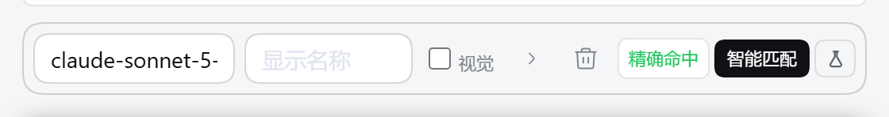
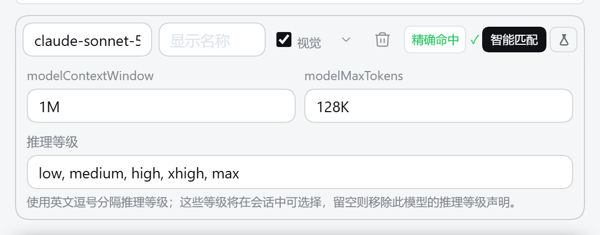
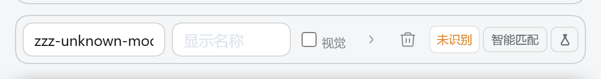
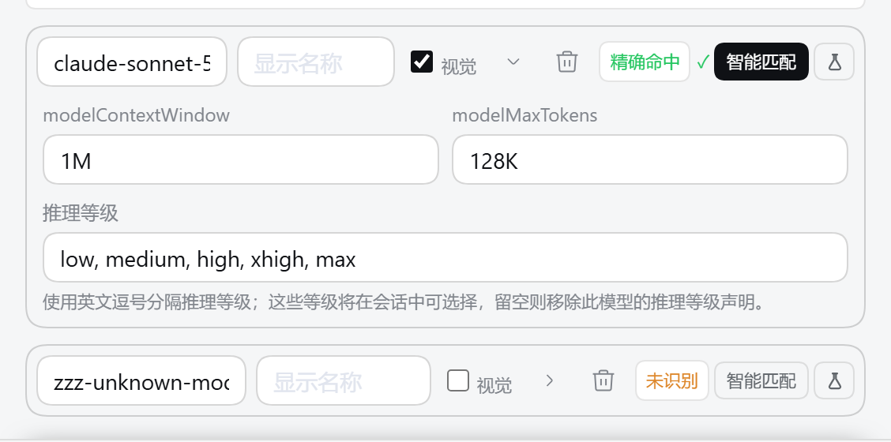

# dsh-model-smart-config

> Smart model setup for **DeepSeek Harness**. Recognize a third-party model ID and fill in its
> **context window / input modalities / reasoning levels** — directly inside the official model row.

`dsh-model-smart-config` 给 DeepSeek Harness 的**第三方 API** 补上「智能配置」：
填完 url / key / model 之后，插件按模型名识别它是谁，把**上下文窗口、输入模态、思考等级**
直接填进官方那一条模型行里 —— 不必再手工编辑 `cordis.patch.yml`。

| | |
|---|---|
| 类型 | DeepSeek Harness 插件（`dsh.bundle` bundle patch + Web client） |
| 规则表 | **201 条**有序正则规则 / **33 家厂商**，每条都带官方文档 `source` |
| 依赖 | 运行时**零依赖**（`@deepseek-ai/*` 由宿主独占供给，插件不声明） |
| 许可 | [MIT](LICENSE) |

## 截图

**一条官方模型行上多了什么**（左：敲入 id 只识别、不写值；右：点「智能匹配」后填值）





**新增模型那一行立刻就有键** · **未识别不写错值** · **不再另起一整块**






> 截图取自真实 Harness 界面（用一个中性草稿 provider，不含任何真实 provider 名或密钥）。

## 英文速览 · English summary

DeepSeek Harness discovers third-party models over the network, and that path only ever yields
`{id, name, contextWindow?, maxTokens?}` — **no modality, no reasoning levels**. This plugin fills
that gap with a curated, ordered-regex rule table:

- **Recognize** the model from its ID (normalize → ordered regex rules → layered merge).
- **Suggest** context window, input modalities (`text` / `image`) and reasoning levels
  (`off` / `minimal` / `low` / `medium` / `high` / `xhigh` / `max`).
- **Fill** the values into the *official* model-row inputs — you stay in control, the plugin never
  writes settings itself, and an unrecognized model is never silently guessed.

Install (GUI: **Plugin Marketplace → Add plugin**, or CLI):

```bash
dsh plugin --profile <profile> add https://github.com/Seller-1990/dsh-model-smart-config
```

Then open **Settings → Models** → any third-party (pi-ai) provider → **Edit** →
expand **自定义设置 / Customized** → every model row now carries a badge and a **Smart match** button.

---

## 起因：官方链路拿不到模态与思考等级

官方 `discoverModels` 的返回**取决于走哪条路径**（详见 [`docs/01-research.md`](docs/01-research.md) §1）：

| 路径 | 返回字段 |
|---|---|
| P1 · provider 在 pi-ai 内置目录 | `{id, name, contextWindow, maxTokens, inputModalities}` |
| P2 · 走网络 `GET {baseURL}/models` | `{id, name, contextWindow?, maxTokens?}` —— **无模态** |

**第三方 provider 必须走 P2，所以实际只拿得到 4 项。** 官方源码注释也明确写了：provider 编辑器
**故意不提供** reasoning effort，因为它是**每模型**能力，只留在配置文件里 —— 即官方把思考等级
留给用户手改。这就是本插件要补的空白。

## 核心设计

**识别是入口。** 不认出模型身份，就判不出能力标签。

```
① 模型识别   归一化模型名 → 有序正则规则匹配 → 分层覆盖合并
② 规格取值   命中即取：多模态 ← 公开信息；思考等级 ← 官方文档条目（表内带 source）
③ 兜底       未命中 → 端点元数据补数值 → 可选实测探测 → 名称启发式只给候选，不自动写
```

思考等级的四条来源按优先级回退（S2 官方服务 → S1 内置表 → S3 实测 → S4 启发式），
详见 [`docs/03-inference-rules.md`](docs/03-inference-rules.md)。

**规则表是有序正则 + 分层覆盖，不是扁平名表** —— `glm-5.3-flash` 要同时继承
`glm-5`（容量）、`glm-5.3`（档位）、`glm-5.3-flash`（多模态）三层信息。
表的范式参考了同类工具的注册表设计（有序规则数组 + 分层覆盖），
分析见 [`docs/03-inference-rules.md`](docs/03-inference-rules.md) §2。

**别名表 `ALIASES`**：第三方聚合站普遍加厂商前缀或改写成别名
（`openai/gpt-4o`、`deepseek-chat` ↔ `deepseek-v4-flash`），归一化剥离 `org/` 之后再过一层别名，
**别名只改匹配用名、不改显示名**。

**不静默写错值是硬底线**：未识别时不写 `input` / `reasoningEfforts`（键直接不出现在结果里），
界面显示「未识别」并允许手动指定。

**不碰配置文件**：安装只动 profile 的 `package.json`（link/git 依赖），不手写
`cordis.patch.yml`；密钥走官方 credentials 面（配置里只留 `apiKeyEnv` 引用）。
填值走**官方受控控件**，持久化由用户按官方「保存」触发 —— 插件自己 `settings.mutate`
会顶掉 revision 导致官方保存撞 `settings/conflict`，所以**插件零写库**。

**实测值不回流离线表**：探测结果只填进当前表单供确认，离线表始终是随插件版本更新的资产。

## 交互：点键才填，填完可改


- **添加模型后那一行立刻就有「智能匹配」键**（空行显示「待填 ID」），不需要先猜 id 才有按钮。
- **敲完 id 只识别、只更新徽标**，绝不自动写值；**真正填值必须由用户点「智能匹配」**
  （「获取 model」批量采纳候选走同一条闸门）。
- **填完可以随便手改**。插件给派发出的 `input` 事件打标，其余写入视为用户手改并登记；
  此后自动路径不再回写你的改动 —— 改 id 也不会抹掉。
- **想重填就再点一次键**（显式覆盖）。
- **未识别不给假值**：徽标显示「未识别」，点键明说「无建议可写」，不动任何字段。

### 配置项

profile 条目上的五个开关（见 [`cordis.patch.yml`](cordis.patch.yml)）：

| 键 | 默认 | 含义 |
|---|---|---|
| `enabled` | `true` | 总开关（false 时行内不渲染任何控件） |
| `autoApplyContext` | `true` | 允许把上下文窗口 / 最大输出填进官方行 |
| `autoApplyModality` | `true` | 允许把输入模态填进官方行 |
| `autoApplyReasoning` | `true` | 允许把思考等级填进官方行 |
| `allowProbe` | `true` | 是否显示「测试」（探测**只在手动点击时**发生） |

## 架构

| 层 | 文件 | 规模 |
|---|---|---|
| Host 半 | [`index.js`](index.js) | 598 行 —— 规则判定、官方目录、实测探测三个 Remote 端点（`msc/infer` / `msc/authoritative` / `msc/probe`） |
| Client 半 | [`client.js`](client.js) | 1673 行 —— 槽位内隐藏锚点 + 逐行容器 + `createPortal`，把「徽标 + 记号 + 智能匹配 + 图标键」渲染进每条官方模型行 |
| 规则数据 | [`data/model-rules.js`](data/model-rules.js) | 2031 行 —— 201 条有序正则规则 / 33 家厂商，每条带官方文档 `source` |
| 判定层 | [`rules/`](rules) | `normalize.js` 47 / `match.js` 77 / `infer.js` 188 行 |
| 测试 | [`test/`](test) | 规则表断言 + 真实模型名识别自检 + 渲染 + 行内挂载 + jsdom 交互链路 |

**行内定位不依赖 CSS-module 哈希类名**（哈希随构建变）。插件只用官方通过
`data-plugin-css` 注入的**稳定字面类名** `label.dshModelModalityToggleCompact` 作行锚点
（每行恰好一个），并显式重写该行的 `gridTemplateColumns` 给自己腾出一格，
撤走时把官方原值还原。

**行内有横向预算**：长文案一律进绝对定位的悬浮弹层（0 宽度），行内只留短词 + 一个字的
状态记号；每个行内元素都有 `max-width` 上限。这条规矩和它的实测数字写在
[`client.js`](client.js) 的 `CSS_TEXT` 上方注释里。

### 生效条件（两半不同）

- **Client 半**（`client.js`）经 HTTP 路由**按磁盘现取**，改完**刷新页面即生效**；
- **Host 半**（`index.js` + `data/model-rules.js`）在进程启动时载入，**改完需重启一次 Harness**。

## 安装

**方式一 · GUI**：打开插件管理器 → **添加插件** → 粘贴本仓库 URL（或本地绝对路径）。

**方式二 · CLI**：

```bash
dsh plugin --profile <profile> add https://github.com/Seller-1990/dsh-model-smart-config
```

`<spec>` 也接受 `file:` / `link:` 前缀、`.tgz`、或**绝对路径**（相对路径会被拒绝）。
装完**无需重启**即可热挂载该 bundle（Client 半即时生效，Host 半在下次启动时载入）。

卸载：

```bash
dsh plugin --profile <profile> remove dsh-model-smart-config
```

## 开发与测试

```bash
npm install
npm test
```

四套测试：`rules`（规则表断言，**41** 项）、`render`（SSR 首帧，**20** 项）、
`placement`（行内挂载与空间预算，**55** 项）、`interaction`（jsdom 里的完整交互链路，**35** 项）。
渲染/交互测试需要一份真实的 React 与 jsdom（已列入 `devDependencies`），
也可以用 `MSC_REACT_ENV` / `MSC_DOM_ENV` 指向别的 `node_modules` 布局。

> 单独跑规则表：`npm run test:rules`。
> 注意 `node --test test/`（目录形式）在当前 Node 下会误报 1 个失败，请按上面的脚本逐文件跑。

## 密钥与网络

- **默认零网络**。「识别」（`infer`）只查仓库内的规则表；「官方目录查询」（`authoritative`）
  只读本机已装的官方模型目录。两者都不发请求。
- **只有你点「测试」时才会联网**：插件按该 provider 的 `apiKeyEnv`（没有就按 provider 名派生
  `*_API_KEY`）在本机 `credentials` 面解析出密钥，然后**只对你在这个 provider 里填的
  `baseURL`** 发一次最小请求，用来看哪些思考等级会被接受。
- **密钥不外流**：不写日志（Host 半只有一条不含任何密钥的 `debug` 日志）、不进返回值、
  **不跨越 Host↔Client 通道**（`credentials.describe`/`resolve` 只在 Host 进程内使用）。
  插件自身不采集、不上报、不落盘任何凭据。
- **不写配置文件**：匹配到的值填进官方受控表单，落库由该 API 卡片自己的「保存」完成。

## 已知限界

- **窄容器**：当模型行可用宽度落到 **< 420px** 左右时，官方两条输入框会被压得很窄。
  这是该容器宽度下的**算术结果**（官方自带图标键 + 插件最小内容 + 两条输入框放不下），
  不是可修的 bug。实测过 6 组网格模板，给轨道加下限只会把溢出从本格转移到整行，更难看，故不采用。
- **长自定义 id**：很长的模型 id 会被官方输入框自身裁切，与本插件无关。
- **规则表是快照**：模型规格会变，表随插件版本更新；表内每条都带 `source`，便于核对与纠错。
  未命中的模型**不会**被猜一个值写进去。

## 文档

| 文件 | 内容 |
|---|---|
| [`docs/01-research.md`](docs/01-research.md) | 调研结论与证据链：官方能力边界、可用通道、环境实测 |
| [`docs/02-architecture.md`](docs/02-architecture.md) | 插件架构、包结构、数据流、卡片交互、实现顺序 |
| [`docs/03-inference-rules.md`](docs/03-inference-rules.md) | **模型识别**与参数判定规则；注册表范式分析（§2） |
| [`docs/04-risks-and-decisions.md`](docs/04-risks-and-decisions.md) | 已定决策、技术风险、验收标准 |

> 安装验证与逐轮实现证据属于本机实测记录，不随公开仓库分发；
> 上文提及的实测数字（几何、字节数、`rev`）均出自那些记录。

## License

[MIT](LICENSE)
